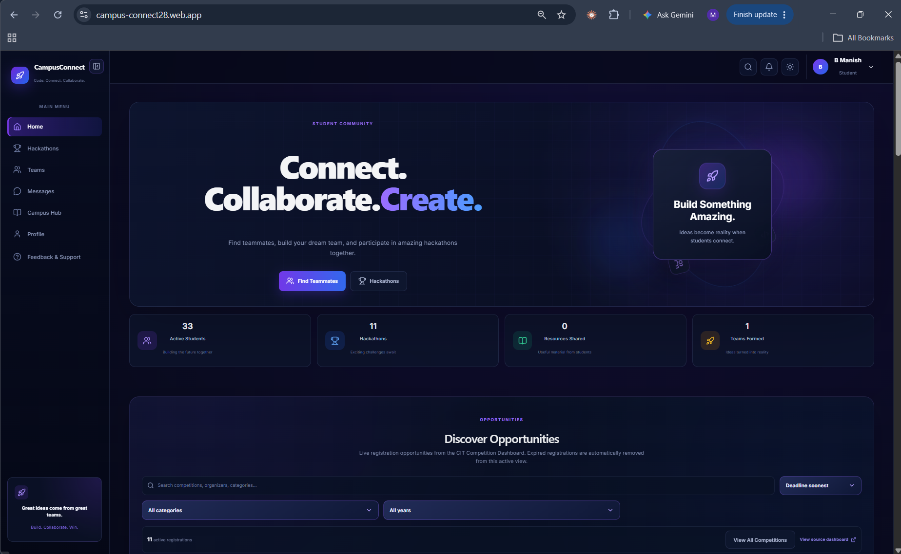
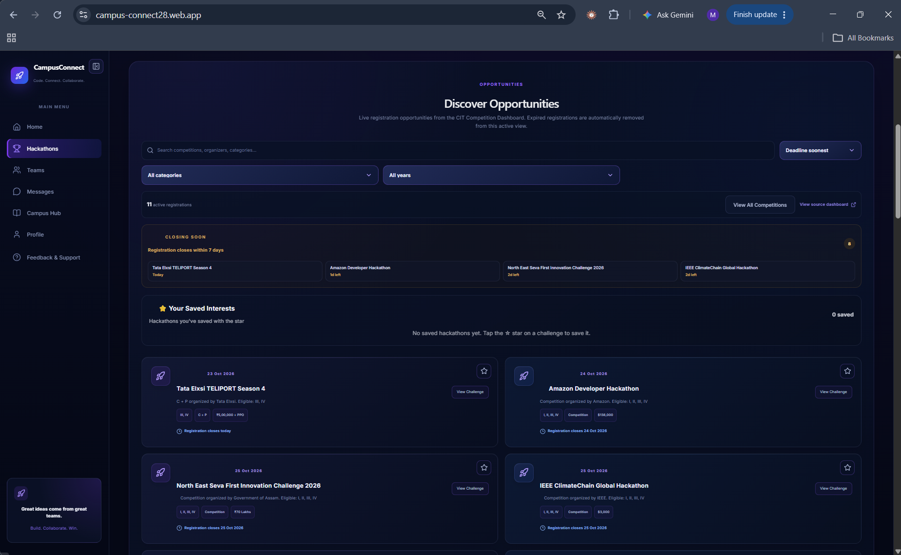
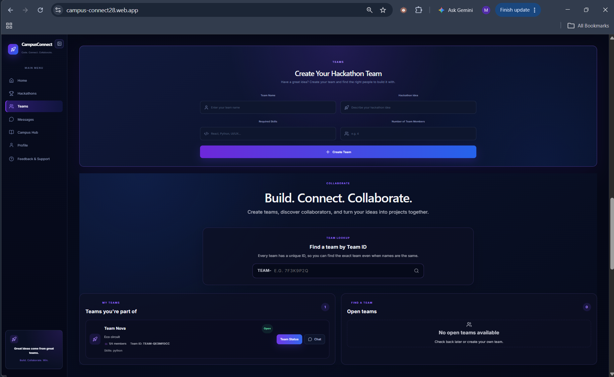
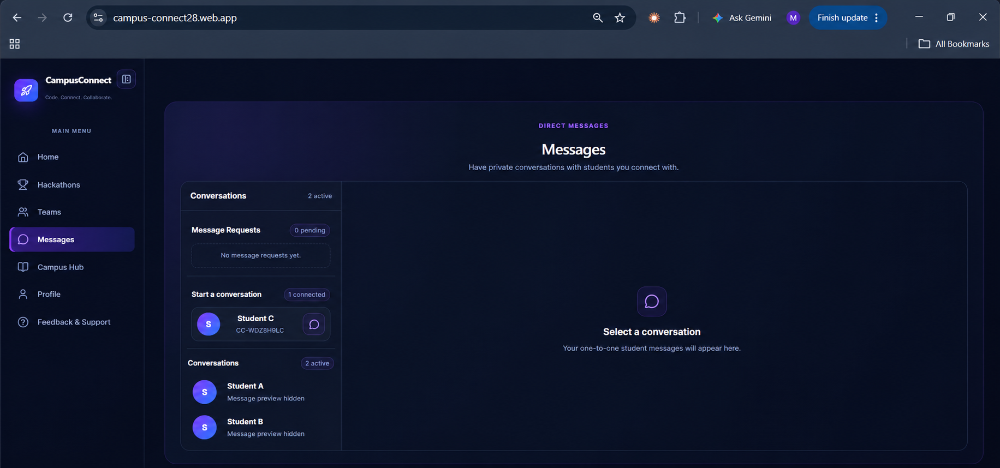
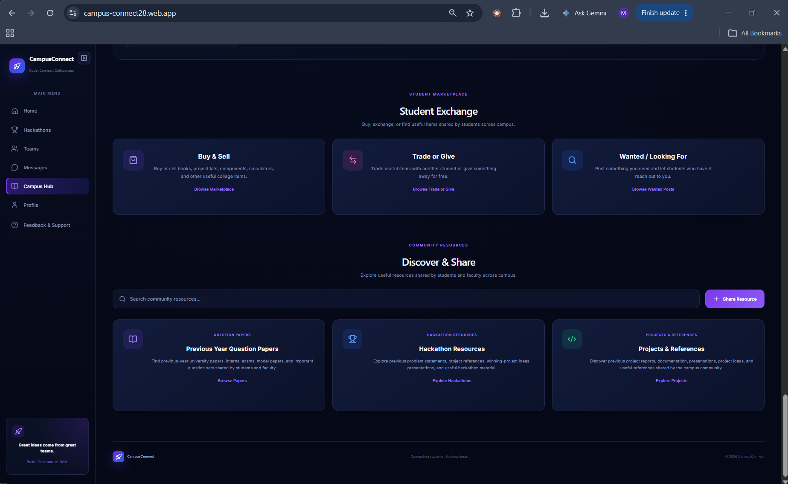
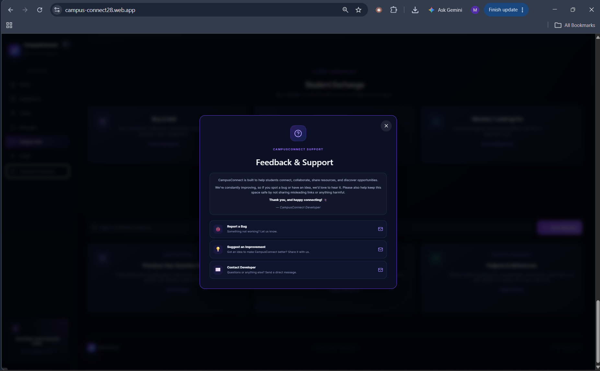

# CampusConnect

CampusConnect is a student collaboration platform designed to help students connect, discover hackathons, form teams, and collaborate on campus opportunities.

**Live website:** https://campus-connect28.web.app/

## Screenshots

### Home


### Hackathons


### Teams


### Messages


### Campus Hub


### Feedback & Support



## Features

- Student profiles and connections
- Hackathon discovery
- Team formation and collaboration
- Direct messaging
- Campus community hub
- Firebase-powered authentication and data services
- Image uploads using ImageKit

## Tech Stack

- React
- Vite
- JavaScript
- Firebase Authentication
- Cloud Firestore
- ImageKit
- Vercel

## Project Structure

```text
CampusConnect/
|-- frontend/
|   |-- api/
|   |   `-- imagekit-auth.js
|   |-- public/
|   |-- src/
|   |   |-- assets/
|   |   |-- App.jsx
|   |   |-- App.css
|   |   |-- firebase.js
|   |   |-- index.css
|   |   `-- main.jsx
|   |-- package.json
|   `-- vite.config.js
|-- functions/
|   |-- index.js
|   `-- package.json
|-- docs/
|   `-- screenshots/
|-- firebase.json
|-- firestore.rules
|-- firestore.indexes.json
|-- package.json
|-- LICENSE
`-- README.md
```


## Getting Started

### Prerequisites

- Node.js and npm
- A configured Firebase project
- ImageKit credentials if using image uploads

### Installation

From the repository root:

```bash
npm install
```

Install frontend dependencies:

```bash
cd frontend
npm install
```

### Environment Variables

Configure the environment variables required by the application in your local environment and deployment settings. See `frontend/.env.example` for the variable names.

Never commit real credentials, private keys, or populated environment files.

### Run Locally

From the `frontend` directory:

```bash
npm run dev
```

### Production Build

```bash
npm run build
```

## Deployment

Live application: https://campus-connect28.web.app/

The project also uses Vercel. Configure the necessary environment variables in your deployment settings before deploying.

## Repository

https://github.com/brmanish7-glitch/CampusConnect

## License

See the `LICENSE` file for the project's licensing terms.